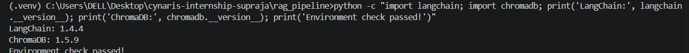

# RAG Pipeline with LangChain & ChromaDB

## Week 1 — Day 1: Environment Setup and Verification

### Objective

Set up a Python environment for the RAG project and verify that LangChain and ChromaDB are installed and working.

### Environment

- Python: 3.14.3
- LangChain: 1.4.4
- ChromaDB: 1.5.9
- Virtual environment: `.venv`

### Setup Steps

1. Created a dedicated `rag_pipeline` project directory.
2. Created and activated a Python virtual environment.
3. Installed the required packages:
   - `langchain`
   - `langchain-community`
   - `chromadb`
   - `sentence-transformers`
4. Verified that LangChain and ChromaDB could be imported successfully.

### Verification Output

```text
LangChain: 1.4.4
ChromaDB: 1.5.9
Environment check passed!
```

### Screenshot Evidence

The following screenshot shows the successful environment verification output.



### Status

- [x] Project directory created
- [x] Virtual environment created and activated
- [x] Required packages installed
- [x] LangChain and ChromaDB imports verified
- [x] Screenshot evidence saved

**Note:** This documents the initial environment setup. Further RAG functionality will be implemented in subsequent tasks.


## Day 2: Explore Codebase Structure

### 1. Project Folder Structure

```text
rag_pipeline/
├── .gitignore
├── project_task_day1.py
├── README.md
├── evidence/
│   └── environment_check.jpg
└── .venv/
```

### 2. Folder and File Descriptions

| File/Folder | Purpose |
|---|---|
| `.gitignore` | Specifies files and folders Git should ignore. |
| `project_task_day1.py` | Verifies LangChain and ChromaDB imports and displays their installed versions. |
| `README.md` | Documents project setup, verification results, and progress. |
| `evidence/` | Stores screenshots used as project evidence. |
| `.venv/` | Contains the Python virtual environment and installed dependencies. |

### 3. Main Entry Point

The current verification script, `project_task_day1.py`, uses the `main()` function as its entry function. The following block calls `main()` when the script is executed directly:

```python
if __name__ == "__main__":
    main()
```

A separate entry point for the complete RAG application has not yet been identified because the application pipeline has not been implemented in the current project structure.

### 4. Key Python Code

The current project contains one top-level Python script:

- **`project_task_day1.py`** — Imports LangChain and ChromaDB, prints their installed versions, and confirms that the environment check passes.

Three separate application modules are not present in the current project structure.

### 5. Configuration and Environment Variables

- The Python virtual environment is stored in `.venv/`.
- `.gitignore` excludes environment-specific files and other files that should not be committed.
- No dedicated application configuration file or `.env` file has been identified in the current project structure.

### 6. Day 2 Status

- [x] Inspected the project directory.
- [x] Identified the existing Python script.
- [x] Reviewed the purpose of the existing script.
- [x] Documented the current folder structure.
- [ ] Locate or obtain the Day 2 starter script, if required by the mentor.
- [ ] Confirm the configuration and module structure when additional application code is available.


### Project Structure Explorer Output

The `project_task_day2.py` script lists the visible top-level project files and folders and reports the total number of Python files, excluding virtual environment paths.

- Top-level files: `README.md`, `project_task_day1.py`, `project_task_day2.py`
- Top-level folder: `evidence/`
- Total Python files (excluding venv): 2

### Main Entry Point and Script Purpose

The current project contains two Python scripts:

- `project_task_day1.py` — verifies LangChain and ChromaDB imports and displays their installed versions.
- `project_task_day2.py` — explores the project directory, lists visible files and folders, displays file sizes, and counts Python files while excluding virtual-environment and `__pycache__` paths.

The Day 2 script executes from top to bottom when run directly. It does not define a separate `main()` function.

A dedicated entry point for the complete RAG application has not yet been identified.

### Configuration and Environment Variables

- `.gitignore` contains rules for files and folders that Git should ignore.
- The current project directory does not contain a visible `.env`, `config.py`, or `settings.py` file.
- No dedicated application configuration or environment-variable file has been identified in the current project.

### Key Python Modules

1. **`langchain`** — Used in `project_task_day1.py` to verify the LangChain installation and display its version. It provides tools for building applications powered by language models.
2. **`chromadb`** — Used in `project_task_day1.py` to verify the ChromaDB installation and display its version. It provides vector storage and similarity search capabilities for RAG applications.
3. **`pathlib`** — Used in `project_task_day2.py` to search the project directory recursively for Python files.

**Note:** These are imported Python/library modules. The current project contains two Python source files; three separate application modules have not yet been identified.